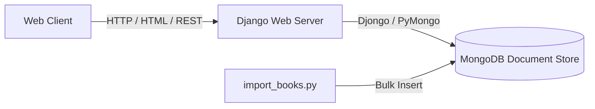

# 📚 Django MongoDB Library — Full-Stack Cataloging Platform

<div align="center">

[](https://python.org)
[](https://djangoproject.com)
[](https://mongodb.com)
[](LICENSE)

<p align="center">
  <b>A modern, high-performance book library web application pairing Django with MongoDB.</b><br>
  Explore, search, filter, and manage thousands of book titles with flexible document-oriented storage.
</p>

</div>

---

## ✨ Features

- **📖 Dynamic Catalog**: Browse books with rich metadata (ISBN, Author, Genre, Publication Year, Synopsis).
- **⚡ Fast Search**: Full-text searching across titles, authors, and keywords with MongoDB indexing.
- **📥 Automated Importer**: CLI script (`import_books.py`) to bulk ingest book datasets from external sources.
- **🛡️ Clean Admin Portal**: Manage collections, user reviews, and inventory levels with customized Django admin views.

---

## 🏗️ Architecture



---

## 🚀 Quick Start

### 1. Prerequisites
- Python 3.11+
- MongoDB instance (Local or MongoDB Atlas)

### 2. Installation
```bash
git clone https://github.com/TORBIomar/django-mongodb-library.git
cd django-mongodb-library

# Create virtual environment
python -m venv venv
source venv/bin/activate  # On Windows: venv\Scripts\activate

# Install requirements
pip install -r requirements.txt

# Run migrations & start server
python manage.py migrate
python manage.py runserver
```

Open `http://localhost:8000` in your browser.

---

## 👨‍💻 Author

**Omar Torbi** — Full-Stack Engineer & Software Architect
- 🌐 **Portfolio**: [omartorbi.engineer](https://www.omartorbi.engineer)
- 💼 **LinkedIn**: [linkedin.com/in/omar-torbi](https://www.linkedin.com/in/omar-torbi-b8340933a/)
- 🐙 **GitHub**: [@TORBIomar](https://github.com/TORBIomar)
- ✉️ **Email**: [torbi.dev@outlook.com](mailto:torbi.dev@outlook.com)
